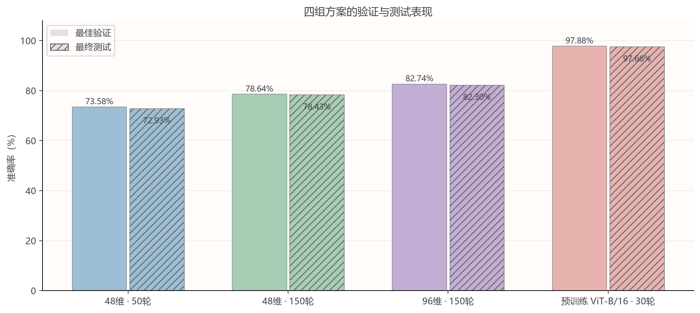

# CIFAR-10 ViT：手写模型与预训练微调

基于PyTorch实现轻量ViT，比较训练预算、模型宽度与图像预训练迁移；提供已执行Notebook、原始实验日志和错误分析。本项目属于学习复现与实验分析，不提出新的模型架构。

## 实验结果

固定seed=42，45,000张训练/5,000张分层验证；最佳权重按验证准确率选择，官方10,000张测试集仅用于最终评估。

|方案|参数量|输入|轮数|最佳验证|最佳轮次|最终测试|
|---|---:|---|---:|---:|---:|---:|
|手写ViT，48维|175,738|32×32|50|73.58%|49|72.93%|
|手写ViT，48维|175,738|32×32|150|78.64%|139|78.43%|
|手写ViT，96维|683,242|32×32|150|82.74%|130|82.30%|
|ImageNet预训练ViT-B/16|85,806,346|224×224|30|97.88%|29|**97.66%**|

预训练方案同时改变外部数据、模型规模、分辨率与优化设置，提升不能归因于单个因素。每组仅运行一个随机种子，不作统计显著性结论。



[完整Notebook](reports/ViT实验对比报告.ipynb) · [汇总表](reports/实验汇总.csv) · [错误分析](reports/error_analysis/错误分析.md)

## 安装

推荐Python 3.11/3.12；先按[PyTorch官方安装说明](https://pytorch.org/get-started/locally/)选择匹配的torch/torchvision及CUDA，再执行：

```console
python -m pip install -r requirements.txt
```

三组新实验记录的环境为torch 2.14.1+cu130、torchvision 0.29.1+cu130；50轮未单独记录环境。requirements是API兼容范围，不能保证所有版本数值完全一致。

## 训练

以下命令从仓库根目录执行。默认数据目录为data/；首次加--download，已有数据可用--data-path指定。

```console
python ViTtrain_gpu1.py --experiment long --download
python ViTtrain_gpu1.py --experiment wide
python ViTtrain_gpu1.py --experiment pretrained
python ViTtrain_gpu1.py --experiment long --epochs 50
```

long默认48维150轮、5轮预热；wide仅宽度改为96维。pretrained为ImageNet-1K V1 ViT-B/16全参数微调，30轮、batch8、3轮预热，骨干学习率3e-5、分类头3e-4；首次下载约330MB预训练权重。
可用--epochs、--batch-size、--seed、--data-path、--output-dir。CPU入口ViTtrain.py复用同一流程。
每次独立保存experiments/<方案>/<时间戳>/，包含配置、日志、best.pth、last.pth和训练摘要。当前不保存优化器状态，不支持中断恢复。

## 测试和单图预测

默认仍测试仓库附带的历史50轮best.pth；其他方案需要显式指定权重，防止误读旧模型。

```console
python ViTtest.py --download
python ViTtest.py --checkpoint experiments/wide/YOUR_RUN/best.pth
python ViTtest.py --checkpoint experiments/pretrained/YOUR_RUN/best.pth --batch-size 8
python ViTtest.py --checkpoint experiments/pretrained/YOUR_RUN/best.pth --image your_image.jpg
```

--data-path指定CIFAR目录，--no-analysis仅评估。兼容CIFAR10_DATA、VIT_CHECKPOINT、VIT_IMAGE环境变量。
测试结果追加到权重同目录training.log；analysis/<时间戳>/保存混淆矩阵、Recall/Precision/F1、错误索引和原图。summary.json是训练摘要，其test_accuracy可能仍为null，以测试日志和analysis/test_metrics.json为准。
测试加载已有checkpoint，不重新下载ImageNet权重。类别顺序：airplane、automobile、bird、cat、deer、dog、frog、horse、ship、truck。

## 报告与检查

```console
jupyter lab reports/ViT实验对比报告.ipynb
python tools/execute_report.py
python -m unittest discover -s tests -v
```

Notebook已嵌入四组马卡龙配色图表，可直接在GitHub查看；日志和配置位于reports/data/，PNG/SVG位于reports/figures/。仅重绘报告不需要PyTorch。
种子42覆盖初始化、CUDA、分层划分和数据加载生成器；未开启严格确定性算法，换硬件/软件可能产生差异。训练准确率包含增强和dropout；训练loss含标签平滑，不能直接与验证/测试普通交叉熵比较。
耗时为日志训练与验证循环之和，不含外部预训练成本；显存为PyTorch张量峰值，不是驱动或整机占用。硬件负载未完全控制，成本图只作描述。

## 文件与权重

仓库保留历史50轮的小型best.pth，其余大权重、数据集、训练输出不提交Git。新权重可通过训练生成，本地发布附件见[发布说明](RELEASE_NOTES.md)。
错误分析只发布统计、矩阵及官方测试集索引，不分发CIFAR原图；运行测试可本地生成。最佳模型错234张，其中猫→狗和狗→猫各30张。
历史优化细节见[优化验证记录](优化验证记录.md)。

## 来源

- [ViT原论文](https://arxiv.org/abs/2010.11929)：模型架构思想。
- [Torchvision ViT-B/16](https://docs.pytorch.org/vision/stable/models/generated/torchvision.models.vit_b_16.html)：标准模型、预训练权重和预处理。
- [CIFAR-10](https://www.cs.toronto.edu/~kriz/cifar.html)：数据集。
- [Happy-LLM](https://github.com/datawhalechina/happy-llm)：预训练/微调学习思路参考，不是视觉权重来源。

轻量ViT沿用本仓库早期学习实现，新增SDPA、AMP、三种实验配置、迁移学习、错误分析和报告。上游代码、模型与数据遵循各自许可；本次未新增独立开源许可证。
