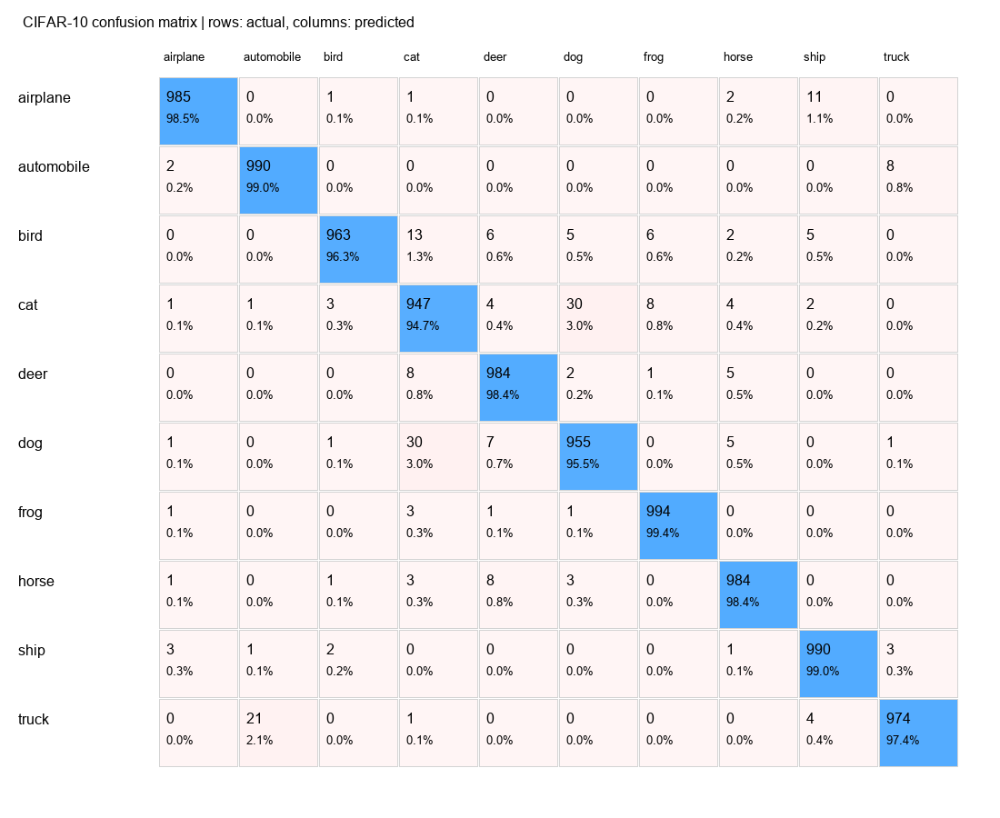

# CIFAR-10 测试错误分析

测试准确率：97.66%；错误：234/10000；平均loss：0.1877。
权重：pretrained best.pth (epoch 29)；训练轮次：29。

混淆矩阵行是真实类别，列是预测类别；格内百分比按真实类别样本数计算。各类别准确率即该类别召回率。

|类别|正确/样本|准确率|Precision|F1|
|---|---:|---:|---:|---:|
|airplane|985/1000|98.50%|99.09%|0.9880|
|automobile|990/1000|99.00%|97.73%|0.9836|
|bird|963/1000|96.30%|99.18%|0.9772|
|cat|947/1000|94.70%|94.14%|0.9442|
|deer|984/1000|98.40%|97.43%|0.9791|
|dog|955/1000|95.50%|95.88%|0.9569|
|frog|994/1000|99.40%|98.51%|0.9895|
|horse|984/1000|98.40%|98.11%|0.9825|
|ship|990/1000|99.00%|97.83%|0.9841|
|truck|974/1000|97.40%|98.78%|0.9809|

## 最多见的误判方向

- dog → cat：30张
- cat → dog：30张
- truck → automobile：21张
- bird → cat：13张
- airplane → ship：11张
- horse → deer：8张
- deer → cat：8张
- cat → frog：8张
- automobile → truck：8张
- dog → deer：7张

错误原图及示例拼图保留于本地，不随仓库分发CIFAR图片；errors.csv提供官方测试集索引。

本地分析目录包含全部错误原图；errors.csv保留官方测试集的0起始索引和预测概率。示例图按预测概率降序选取最多40张，不代表所有错误的分布；概率不是经过校准的置信保证。
本分析用于描述固定模型的测试错误，不依据这些测试图片反复选择超参数。